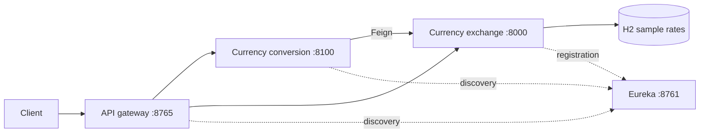

# Microservices Tutorial

Java and Spring learning exercises based on the [in28Minutes course](https://www.udemy.com/course/microservices-with-spring-boot-and-spring-cloud/). The projects explore service discovery, an API gateway, service-to-service calls, distributed tracing, Docker and Kubernetes.

## Run the currency example

You need JDK 25 and network access for the Maven wrapper to download dependencies. Each service runs in its own terminal. From the repository root, start these applications in order:

| Order | Directory | Default port |
| --- | --- | --- |
| 1 | `01-in28minutes/03-docker/03-naming-server` | 8761 |
| 2 | `01-in28minutes/03-docker/01-currency-exchange-service` | 8000 |
| 3 | `01-in28minutes/03-docker/02-currency-conversion-service` | 8100 |
| 4 | `01-in28minutes/03-docker/04-api-gateway` | 8765 |

In each directory, run `./mvnw spring-boot:run` on macOS or Linux, or `.\mvnw.cmd spring-boot:run` on Windows. Allow time for the services to register with Eureka; check the dashboard at <http://localhost:8761/>.

Then try:

```sh
curl http://localhost:8765/currency-conversion/from/CAD/to/INR/quantity/12
```

In PowerShell, use `curl.exe` instead. With the seeded sample rate of 62.40, the response's `totalCalculatedAmount` should be 748.80. Rates are demo data. See the [project reference](01-in28minutes/03-docker/PROJECT-REFERENCE.md) for more endpoints, optional Zipkin setup and troubleshooting.

## How the example fits together



The gateway routes requests using service discovery; conversion calls exchange to obtain a rate. The example also includes an alternative direct REST call, tracing instrumentation and a resilience demonstration. The [project reference](01-in28minutes/03-docker/PROJECT-REFERENCE.md) explains their behavior and limitations.

## Tests

Run `./mvnw test` (Windows: `.\mvnw.cmd test`) in each application directory. The existing context tests are not full end-to-end integration tests; the gateway request above exercises the running services together.

## Explore the repository

- [Project and startup guides](01-in28minutes/README.md)
- [Properties and annotations in simple English](PROPERTIES-AND-ANNOTATIONS.md)
- [Interview guide and practice questions](INTERVIEW-GUIDE.md)
- [Docker, Compose, and Kubernetes interview guide](CONTAINER-INTERVIEW-GUIDE.md)
- [Docker tutorial: URLs, components, and tracing reference](01-in28minutes/03-docker/PROJECT-REFERENCE.md)

These are learning examples rather than production-ready services. See the reference guide for known limitations, including error handling and the use of in-memory sample data.
